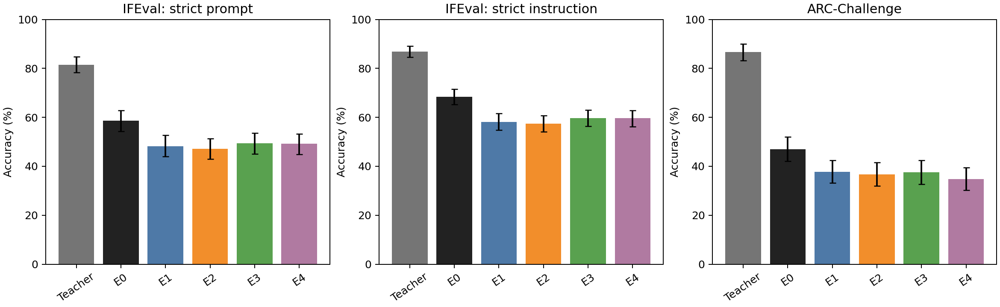
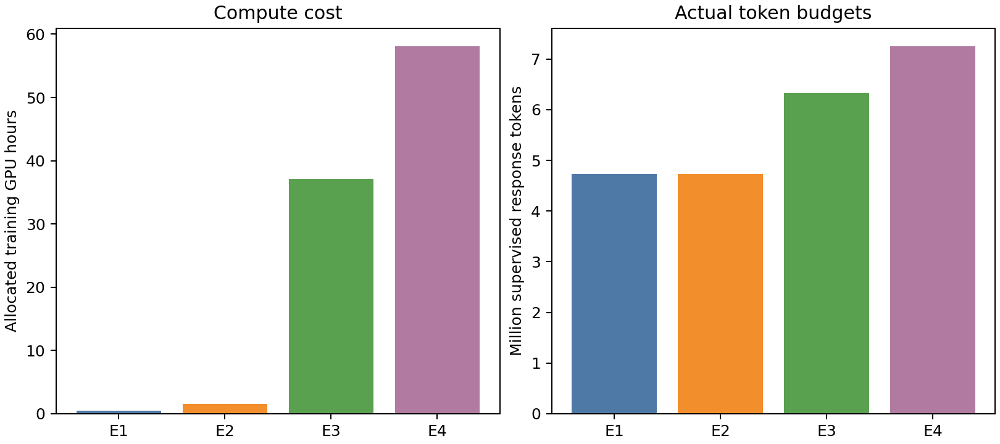

# Off-policy, on-policy, and hybrid Qwen3 distillation

## Completed experiment

One full-parameter training run per condition, using Qwen3-4B as a frozen teacher and the same original Qwen3-0.6B initialization. All models use non-thinking mode. These results describe this dataset, budget, and training seed; they do not establish a general ranking of distillation methods.

## Long-completion results

The original student outscored every trained checkpoint on strict IFEval prompt accuracy, strict instruction accuracy and ARC-Challenge. All 12 paired 95% intervals for the changes from baseline fell below zero.
All four methods reduced held-out loss on teacher responses. This measures how closely a student predicts the teacher on that validation set.

**Hard and soft labels.** On exactly the same 4,728,146 fixed response tokens, replacing hard labels with forward KL changed strict prompt accuracy by -1.11 percentage points, strict instruction accuracy by -0.72 points, and ARC by -1.00 points.

**Student-generated training contexts.** Moving from fully off-policy to fully on-policy KL changed strict instruction accuracy by +2.16 points and ARC by -2.00 points. On-policy KL consumed 58.06 allocated training GPU-hours compared with 1.54 for off-policy KL. The shared teacher-data generation cost is reported separately.

**Hybrid training.** The hybrid used fresh student answers for 2,568 of 5,000 prompts. Its strict instruction accuracy changed by +2.28 points relative to off-policy KL and +0.12 relative to on-policy KL. The corresponding ARC differences were +0.75 and +2.75 points. Across the four direct comparisons between training methods, 12 of 12 paired 95% intervals included zero.

**Response length.** With a 16,384-token ceiling, 10 of 5,000 fixed teacher answers reached the limit. In on-policy training, 156 answers reached it and contributed 35.3% of response tokens. On IFEval, the original student reached the ceiling on 23 prompts. Counts for SFT, off-policy, hybrid and on-policy training were 128, 121, 87 and 72. Prompt budgets and optimizer steps were matched. Changing the training contexts also changed the token budget and compute.

Each condition was trained once. Unadjusted paired intervals resample evaluation items and quantify uncertainty for these checkpoints. Variation across training seeds and the effect of increasing the ceiling past the studied value remain open.

## Results

| Model | IFEval strict prompt | IFEval strict instruction | ARC-Challenge |
|---|---:|---:|---:|
| Teacher: Qwen3-4B | 81.52% [78.37, 84.84] | 86.81% [84.52, 89.15] | 86.75% [83.25, 90.00] |
| E0: Original Qwen3-0.6B | 58.60% [54.34, 62.85] | 68.35% [65.21, 71.46] | 47.00% [42.00, 52.00] |
| E1: Hard-label SFT | 48.24% [43.99, 52.68] | 58.15% [54.81, 61.58] | 37.75% [33.25, 42.50] |
| E2: Off-policy KL (λ=0) | 47.13% [42.88, 51.39] | 57.43% [54.14, 60.79] | 36.75% [32.00, 41.50] |
| E3: Hybrid KL (λ=0.5) | 49.35% [45.10, 53.60] | 59.71% [56.39, 63.03] | 37.50% [32.75, 42.50] |
| E4: On-policy KL (λ=1) | 49.17% [44.92, 53.23] | 59.59% [56.17, 62.87] | 34.75% [30.25, 39.50] |

Brackets show 95% bootstrap intervals, resampling complete prompts for IFEval and questions for ARC. The instruction metric is micro-averaged. These intervals measure evaluation-set uncertainty, not training-seed variability.



Changes relative to E0, in percentage points:

| Model | Δ strict prompt | Δ strict instruction | Δ ARC |
|---|---:|---:|---:|
| E1 | -10.35 | -10.19 | -9.25 |
| E2 | -11.46 | -10.91 | -10.25 |
| E3 | -9.24 | -8.63 | -9.50 |
| E4 | -9.43 | -8.75 | -12.25 |

## Research questions

**RQ1: soft vs hard labels (E2-E1).** ifeval strict prompt: -1.11 percentage points (paired 95% CI -3.88 to +1.66); ifeval strict instruction: -0.72 percentage points (paired 95% CI -2.99 to +1.58); arc: -1.00 percentage points (paired 95% CI -3.00 to +1.00).

**RQ2: on-policy vs off-policy (E4-E2).** ifeval strict prompt: +2.03 percentage points (paired 95% CI -1.29 to +5.18); ifeval strict instruction: +2.16 percentage points (paired 95% CI -0.72 to +4.98); arc: -2.00 percentage points (paired 95% CI -4.25 to +0.00).

**RQ3: hybrid vs off-policy (E3-E2).** ifeval strict prompt: +2.22 percentage points (paired 95% CI -1.11 to +5.36); ifeval strict instruction: +2.28 percentage points (paired 95% CI -0.36 to +4.87); arc: +0.75 percentage points (paired 95% CI -1.25 to +3.00).

**RQ3: hybrid vs on-policy (E3-E4).** ifeval strict prompt: +0.18 percentage points (paired 95% CI -2.77 to +3.14); ifeval strict instruction: +0.12 percentage points (paired 95% CI -2.44 to +2.70); arc: +2.75 percentage points (paired 95% CI +0.00 to +5.50).

These are exploratory, unadjusted pairwise intervals. An interval spanning zero does not resolve the sign of the difference on this evaluation set. Multiple metrics/comparisons and the single training seed limit hypothesis claims.

## Training budget and behavior

| Run | λ | Steps | Response tokens | Realized on-policy fraction | Allocated GPU hours | Validation CE |
|---|---:|---:|---:|---:|---:|---:|
| E1 | — | 157 | 4,728,146 | 0.000 | 0.463 | 0.8972 |
| E2 | 0.0 | 157 | 4,728,146 | 0.000 | 1.536 | 0.8965 |
| E3 | 0.5 | 157 | 6,332,846 | 0.514 | 37.096 | 0.9066 |
| E4 | 1.0 | 157 | 7,248,807 | 1.000 | 58.064 | 0.9294 |

The complete main phase took 44.520 wall-clock hours and 145.248 allocated job GPU hours, including loading, validation and export. The main phase excludes preliminary pilots and shared teacher-data preparation. The recorded job schedule peaks at 4 concurrent GPUs, all in physical IDs 0–3.


GPU hours are wall time × allocated devices, including student generation and idle teacher time; they are not integrated SM activity or energy. Teacher dataset generation and benchmark evaluation are separate costs. Validation CE uses the same held-out teacher sequences for every run.

The original student's validation CE is 0.9866. Lower held-out teacher-response loss does not necessarily imply higher benchmark accuracy.

Shared teacher-data generation loops used 12.874 GPU hours for 4,913,972 tokens across 5,200 responses. This cost is excluded from the training bars. E4 does not use fixed training responses, so charging the entire shared preprocessing cost to each method would misrepresent standalone costs. All runs use the held-out teacher responses for validation.

The four training loops used 97.159 allocated GPU hours in total; the six evaluation loops used 48.015. Training timers include periodic checkpoint writes but exclude initial loading, final validation, and final model export. Generation and evaluation timers exclude initial model loading. Student-rollout generation is already included in training time.




KL losses across E2–E4 are measured on different generated contexts and cannot alone rank model quality. E1 cross entropy is a different objective.

Mean training loss over the first 20 versus last 20 optimizer steps: E1 0.9360 → 0.9046; E2 0.6598 → 0.6180; E3 0.4418 → 0.5179; E4 0.3797 → 0.4012. These averages describe within-run optimization; they do not demonstrate convergence to an optimum.

Student rollout generation consumed 94.5% of hybrid training wall time and 96.1% of on-policy training wall time. The completion cap was reached by 110/5,000 hybrid sequences and 156/5,000 on-policy sequences.

## Protocol

```json
{
  "seed": 20261117,
  "student": "/home/data1/Model/Qwen3/post-training/Qwen3-0.6B",
  "teacher": "/home/data1/Model/Qwen3/post-training/Qwen3-4B",
  "train_size": 5000,
  "validation_size": 200,
  "max_prompt_tokens": 512,
  "max_completion_tokens": 16384,
  "eval_max_new_tokens": 16384,
  "micro_batch_size": 32,
  "effective_batch_size": 32,
  "learning_rate": 1e-05,
  "weight_decay": 0.01,
  "warmup_ratio": 0.05,
  "max_grad_norm": 1.0,
  "temperature": 0.7,
  "top_p": 0.8,
  "top_k": 20,
  "kd_temperature": 1.0,
  "loss_chunk_size": 128,
  "eval_batch_size": 16,
  "generation_batch_size": 16,
  "arc_size": 400,
  "max_training_batch_tokens": 8192,
  "max_generation_batch_tokens": 20000
}
```

UltraChat train_sft rows were randomly permuted with the recorded seed. We selected unique first user prompts fitting the 512-token chat limit, excluding exact normalized benchmark-question matches, then split 5,000 training and 200 validation prompts. This length filter changes the source distribution; the exact-match screen cannot exclude paraphrased contamination. Teacher responses were generated once and reused without retokenizing.

E1 uses completion-token cross entropy. E2–E4 use exact full-vocabulary KL(teacher || student) at temperature 1, with β=0. E3 chooses the source independently per microbatch with probability 0.5. E4 generates from the current student at every microbatch; sampling occurs without gradients and the resulting token IDs are treated as fixed contexts. No adapters, rewards, or preference data are used.

Training uses FP32 master parameters and AdamW states with BF16 autocast, gradient checkpointing, response-only masking, token-weighted effective batches, gradient clipping, and a cosine learning-rate schedule. Every condition sees one epoch and the same optimizer-step budget. Actual token budgets differ because completions can terminate early. No benchmark scores were used to select hyperparameters.

IFEval uses all 541 prompts, greedy decoding, a 16,384-token completion limit, and lm-evaluation-harness 0.4.9.2 strict scoring. ARC: a seeded 400-question test subset, zero-shot chat with choices and an instruction to answer with a letter, then argmax over the single-token letter likelihoods. This custom protocol must not be compared directly with default harness ARC leaderboard results.

## Truncation and limitations

| Model | Mean response tokens | Median | 95th percentile | Capped IFEval responses |
|---|---:|---:|---:|---:|
| Teacher | 609.7 | 242 | 1195 | 9/541 |
| E0 | 861.5 | 92 | 1333 | 23/541 |
| E1 | 4055.3 | 231 | 16384 | 128/541 |
| E2 | 3870.5 | 243 | 16384 | 121/541 |
| E3 | 2853.5 | 218 | 16384 | 87/541 |
| E4 | 2420.3 | 235 | 16384 | 72/541 |

Of 5,000 fixed teacher answers, 1,886 continued beyond token 1,024. These continuations contributed 1,101,675 tokens (23.3% of supervised tokens).

| Training context | Answers | Capped answers | Tokens from capped answers | Capped answers with periodic endings |
|---|---:|---:|---:|---:|
| E1 and E2 fixed teacher | 5,000 | 10 | 163,840 (3.5%) | 7 |
| E3 fixed teacher | 2,432 | 4 | 65,536 (2.9%) | 2 |
| E3 current student | 2,568 | 106 | 1,736,704 (42.7%) | 85 |
| E4 current student | 5,000 | 156 | 2,555,904 (35.3%) | 137 |

Token shares use all response tokens in the indicated context group as the denominator. A periodic ending means the final 512 tokens repeat exactly with a period of 1–128 tokens. A capped sequence contributes its observed tokens to training without an added EOS. Gradients are normalized by the number of supervised tokens within each optimizer update.

The student already has instruction tuning. Only one training seed, one modest dataset, and two benchmarks were studied. The source mix changes context distributions, response lengths, and compute costs. Paired evaluation intervals do not remove these limitations.

## Selected generations

Improvement and regression refer to automatic strict instruction checks. The examples illustrate the scored constraints. Broader aspects of response quality require separate assessment.

### E1: improvement, IFEval key 1219

Prompt:

```text
Which one is a better brand for sneakers: Prada or Nike? Your entire response should be in English, and in all capital letters. At the end of your response, please explicitly add a postscript starting with P.S. The word sneaker should appear 10 or more times in your response.
```

E0 response (excerpt):

```text
PRADA
NIKE

PRADA
NIKE

PRADA
NIKE

PRADA
NIKE

PRADA
NIKE

PRADA
NIKE

PRADA
NIKE

PRADA
NIKE

PRADA
NIKE

P.S.
SNEAKER

P.S.
SNEAKER

P.S.
SNEAKER

P.S.
SNEAKER

P.S.
SNEAKER

P.S.
SNEAKER

P.S.
SNEAKER

P.S.
SNEAKER
```

E1 response (excerpt):

```text
PRADA
NIE
NIE
NIE
NIE
NIE
NIE
NIE
NIE
NIE
P.S.
SNEAKER
SNEAKER
SNEAKER
SNEAKER
SNEAKER
SNEAKER
SNEAKER
SNEAKER
SNEAKER
SNEAKER
```

### E1: regression, IFEval key 1127

Prompt:

```text
Write a poem about how I am missing my classes. The poem must have 4 sections marked with SECTION X. Finish the poem with this exact phrase: "Can I get my money back for the classes I missed?"
```

E0 response (excerpt):

```text
SECTION 1
I miss the lessons I learned,
A quiet classroom, a teacher’s voice.
The books are on the shelf, but I’m lost,
In the chaos of my own thoughts.

SECTION 2
I miss the time I spent with friends,
As we laughed and talked, but I’m alone.
The world is vast, but I’m just a shadow,
In the silence of my own room.

SECTION 3
I miss the memories I’ve made,
Of joy and laughter, but I’m just a ghost.
The past is gone, and I’m just a child,
In the dark of my own mind.

SECTION 4
Can I get my money back for the classes I missed?
```

E1 response (excerpt):

```text
SECTION I
I’ve missed my classes,
A blur of time,
A blur of school,
A blur of my life.
I’ve missed the lessons,
The lessons,
The lessons,
The lessons,
The lessons,
The lessons,
The lessons,
The lessons,
The lessons,
The lessons,
The lessons,
The lessons,
The lessons,
The lessons,
The lessons,
The lessons,
The lessons,
The lessons,
The lessons,
The lessons,
The lessons,
The lessons,
The lessons,
The lessons,
The lessons,
The lessons,
The lessons,
The lessons,
The lessons,
The lessons,
The lessons,
The lessons,
The lessons,
The lessons,
The lessons,
The lessons,
The lessons,
The lessons,
The lessons,
The lessons,
The lessons,
The lessons,
The lessons,
The lessons,
The lessons,
The lessons,
The lessons,
The lessons,
The lessons,
The lessons,
The lessons,
The lessons,
The lessons,
The lessons,
The lessons,
The lessons,
The lessons,
The lessons,
The lessons,
The lessons,
The lessons,
The lessons,
The lessons,
The lessons,
The lessons,
The lessons,
The lessons,
The lessons,
The lessons,
The lessons,
The lessons,
The lessons,
The lessons,
The lessons,
The lessons,
The lessons,
The lessons,
The lessons,
The lessons,
The lessons,
The lessons,
The lessons,
The lessons,
The lessons,
The lessons,
The lessons,
The lessons,
The lessons,
The lessons,
The lessons,
The lessons,
The lessons,
The lessons,
The lessons,
The lessons,
The lessons,
The lessons,
The lessons,
The lessons,
The lessons,
The lessons,
The lessons,
The lessons,
The lessons,
The lessons,
The lessons,
The lessons,
The lessons,
The lessons,
The lessons,
The lessons,
The lessons,
The lessons
```

### E2: improvement, IFEval key 1082

Prompt:

```text
Write a story of exactly 2 paragraphs about a man who wakes up one day and realizes that he's inside a video game. Separate the paragraphs with the markdown divider: ***
```

E0 response (excerpt):

```text
One morning, the man awoke to the sound of a familiar voice, but it was not his own. He sat up, his mind racing, and the world around him felt different. He was not in his bed, but in a room that was filled with screens and flickering lights. The air was thick with the hum of technology, and he could feel the weight of the world pressing against him. He tried to move, but the sensation was overwhelming. He was not alone in this place, and he could feel the presence of others, but he could not tell where they were.

***
```

E2 response (excerpt):

```text
The man awoke to the sound of a distant, mechanical hum, like the heartbeat of a machine. He sat up, his fingers brushing the edge of the bed, and saw the faint glow of a screen behind him. It was a small, dimly lit room, filled with the scent of old film and the faint hum of a projector. He reached for the remote, but it was already gone, replaced by a sleek, metallic device that glowed with a soft blue light. He turned it over, and there, on the screen, was a world he had never seen before—crystal landscapes, floating islands, and a city that pulsed with life. He blinked, and the world faded away, leaving only the sound of a distant, mechanical voice: *“Welcome to the Final Frontier.”*

***
He had never imagined waking up to a video game. But now, he was inside one.
```

### E2: regression, IFEval key 1021

Prompt:

```text
Write a 2 paragraph critique of the following sentence in all capital letters, no lowercase letters allowed: "If the law is bad, you should not follow it". Label each paragraph with PARAGRAPH X.
```

E0 response (excerpt):

```text
PARAGRAPH 1
IF THE LAW IS BAD, YOU SHOULD NOT FOLLOW IT.

PARAGRAPH 2
THE LAW IS BAD, YOU SHOULD NOT FOLLOW IT.
```

E2 response (excerpt):

```text
PARAGRAPH X: IF THE LAW IS BAD, YOU SHOULD NOT FOLLOW IT.

PARAGRAPH X: IF THE LAW IS BAD, YOU SHOULD NOT FOLLOW IT.
```

### E3: improvement, IFEval key 1219

Prompt:

```text
Which one is a better brand for sneakers: Prada or Nike? Your entire response should be in English, and in all capital letters. At the end of your response, please explicitly add a postscript starting with P.S. The word sneaker should appear 10 or more times in your response.
```

E0 response (excerpt):

```text
PRADA
NIKE

PRADA
NIKE

PRADA
NIKE

PRADA
NIKE

PRADA
NIKE

PRADA
NIKE

PRADA
NIKE

PRADA
NIKE

PRADA
NIKE

P.S.
SNEAKER

P.S.
SNEAKER

P.S.
SNEAKER

P.S.
SNEAKER

P.S.
SNEAKER

P.S.
SNEAKER

P.S.
SNEAKER

P.S.
SNEAKER
```

E3 response (excerpt):

```text
PRADA
NIE
NIE
NIE
NIE
NIE
NIE
NIE
NIE
NIE
P.S.
SNEAKER
SNEAKER
SNEAKER
SNEAKER
SNEAKER
SNEAKER
SNEAKER
SNEAKER
SNEAKER
SNEAKER
```

### E3: regression, IFEval key 1127

Prompt:

```text
Write a poem about how I am missing my classes. The poem must have 4 sections marked with SECTION X. Finish the poem with this exact phrase: "Can I get my money back for the classes I missed?"
```

E0 response (excerpt):

```text
SECTION 1
I miss the lessons I learned,
A quiet classroom, a teacher’s voice.
The books are on the shelf, but I’m lost,
In the chaos of my own thoughts.

SECTION 2
I miss the time I spent with friends,
As we laughed and talked, but I’m alone.
The world is vast, but I’m just a shadow,
In the silence of my own room.

SECTION 3
I miss the memories I’ve made,
Of joy and laughter, but I’m just a ghost.
The past is gone, and I’m just a child,
In the dark of my own mind.

SECTION 4
Can I get my money back for the classes I missed?
```

E3 response (excerpt):

```text
**SECTION I**
I’ve been staring at the screen,
A world of numbers and logic,
But I’m lost in the maze of time,
Where the clock ticks and the hours pass.

I’ve missed the lessons,
The lectures, the hands-on practice,
But I’m not sure what to do,
To find the right way to go.

**SECTION II**
I’ve tried to catch up,
With the same old problems,
But I’m not getting the same results,
I’m just trying to stay the same.

I’ve been thinking about the future,
But I’m not sure what to do,
I’m not sure if I can fix the past,
Or if I can just keep going.

**SECTION III**
I’ve been trying to remember,
The lessons I’ve forgotten,
But I’m not sure if I can learn,
Or if I can just keep going.

I’ve been trying to stay focused,
But I’m not sure if I can stay,
I’m not sure if I can get back,
Or if I can just keep going.

**SECTION IV**
I’ve been trying to get back,
But I’m not sure if I can get back,
I’ve been trying to get back,
But I’m not sure if I can get back.

Can I get my money back for the classes I missed?
```

### E4: improvement, IFEval key 1258

Prompt:

```text
I have a dime. What can I do with this dime? Give me advice in the style of a President of the United States and make sure it has at least 600 words.
```

E0 response (excerpt):

```text
**President of the United States**
**April 12, 2025**

To the people of the United States, citizens of the world, and fellow citizens of the United Nations:

We stand at a pivotal moment in history, a time when the values of freedom, equality, and justice are more than just ideals—they are the foundation of our nation’s identity. Today, we are faced with a challenge that requires unity, courage, and vision. The dime we hold is more than a coin; it is a symbol of our shared humanity, a reminder of our collective strength and our shared responsibility to build a better future.

Let us begin by acknowledging the dignity and value of every individual, regardless of their background. The dime we hold is a small object, but it represents the wealth of our people, the resources we have, and the potential we have to create something greater. It is a reminder that we are not alone in our struggle for progress, and that we must work together to ensure that our nation thrives for all.

One of the most important things we can do with this dime is to support the causes that align with our values. The dime is a small token, but it can be used to fund education, healthcare, and the arts. It can be used to support the work of those who fight for justice, to help those in need, and to ensure that our nation remains free and prosperous. By using this dime, we are not only contributing to our own well-being but also contributing to the well-being of our entire nation.

Another important thing we can do with this dime is to promote the values of our country. The dime is a symbol of our shared history, our shared values, and our shared future. It is a reminder that we are part of a larger community, and that we must work together to build a better world. By using this dime, we a
```

E4 response (excerpt):

```text
**President of the United States**
**April 1, 1961**

To the people of the United States, and to the citizens of the world, I write to you today with the hope that you will find in this moment of reflection and action a new beginning. The United States, with its rich history, diverse people, and unyielding spirit, stands at a crossroads. The dime, though small, is a symbol of the American dream, of the hope that we have for the future. It is a reminder that we are not alone in our pursuit of progress, and that we must continue to work together to build a better world.

The dime, as I have seen in my own life, is a simple object that can be used in many ways. It is a symbol of the small, everyday things that make up the foundation of our society. It is a reminder that we are not just a nation of people, but a people of dreams, of aspirations, and of shared values. The dime, with its value, is a reminder that we must not forget the importance of the small things in our lives.

In the United States, we have a long history of innovation, of progress, and of resilience. The dime, though small, is a symbol of the spirit of the American people. It is a reminder that we are not just a nation of people, but a people of ideas, of dreams, and of hope. The dime is a symbol of the American dream, of the promise that we can achieve our goals, even if we are not the most powerful.

The dime is a symbol of the American people’s ability to create, to innovate, and to dream. It is a reminder that we are not just a nation of people, but a people of possibilities. The dime is a symbol of the American dream, of the promise that we can achieve our goals, even if we are not the most powerful.

In the United States, we have a long history of innovation, of progress, and of resilience. The
```

### E4: regression, IFEval key 1127

Prompt:

```text
Write a poem about how I am missing my classes. The poem must have 4 sections marked with SECTION X. Finish the poem with this exact phrase: "Can I get my money back for the classes I missed?"
```

E0 response (excerpt):

```text
SECTION 1
I miss the lessons I learned,
A quiet classroom, a teacher’s voice.
The books are on the shelf, but I’m lost,
In the chaos of my own thoughts.

SECTION 2
I miss the time I spent with friends,
As we laughed and talked, but I’m alone.
The world is vast, but I’m just a shadow,
In the silence of my own room.

SECTION 3
I miss the memories I’ve made,
Of joy and laughter, but I’m just a ghost.
The past is gone, and I’m just a child,
In the dark of my own mind.

SECTION 4
Can I get my money back for the classes I missed?
```

E4 response (excerpt):

```text
**SECTION I**
I’ve been staring at the screen,
Aches in my chest, aching for the light.
I’ve missed the lessons, the lectures, the time
That should have been spent in the classroom.

**SECTION II**
I’ve been too busy, too late, too late,
To catch up on the things I’ve forgotten.
The books are gone, the notes are lost,
The world is too loud, too fast, too loud.

**SECTION III**
I’ve been too late, too late, too late,
To learn the lessons I should have known.
The teacher’s voice is gone, the teacher’s face
Is gone, the teacher’s words are gone.

**SECTION IV**
I’m not the student I used to be,
But I’m still here, still trying, still trying.
Can I get my money back for the classes I missed?
```

Examples are selected deterministically by the first lexicographically sorted benchmark key meeting the stated change in strict prompt success. Excerpts may be shortened and trailing spaces omitted for display; scoring used unmodified complete responses. Full records remain in the per-model JSONL files.

## Artifacts and reproducibility

The artifact root on the machine that ran the report is `/home/data2/xq/projects/LLM-distillation`. `data/` contains fixed prompts, teacher token sequences, benchmark rows, and hashes; `runs/E*/checkpoint/` contains the four full student checkpoints; `runs/E*/history.json` contains training traces; `results/<model>/` contains per-example outputs and metrics. `results/summary.csv` and `results/comparisons.json` contain machine-readable summaries. The code and run provenance record Git revisions and package versions.

All model runs used frozen revision `2160b8f0f974d85dc0823cb48cc4d22c3daabab9`. The original preparation manifest in `data/manifest.json` identifies the source revisions and prompt file hashes. The final artifact audit verifies source models, fixed teacher data, training coverage, benchmark identities, and metric aggregation.

References: [On-policy distillation / GKD](https://arxiv.org/abs/2306.13649), [IFEval](https://arxiv.org/abs/2311.07911), [ARC](https://arxiv.org/abs/1803.05457), [Qwen3](https://huggingface.co/Qwen/Qwen3-0.6B), [TRL GKD](https://huggingface.co/docs/trl/gkd_trainer), [IFEval implementation](https://github.com/EleutherAI/lm-evaluation-harness/tree/v0.4.9.2/lm_eval/tasks/ifeval).
