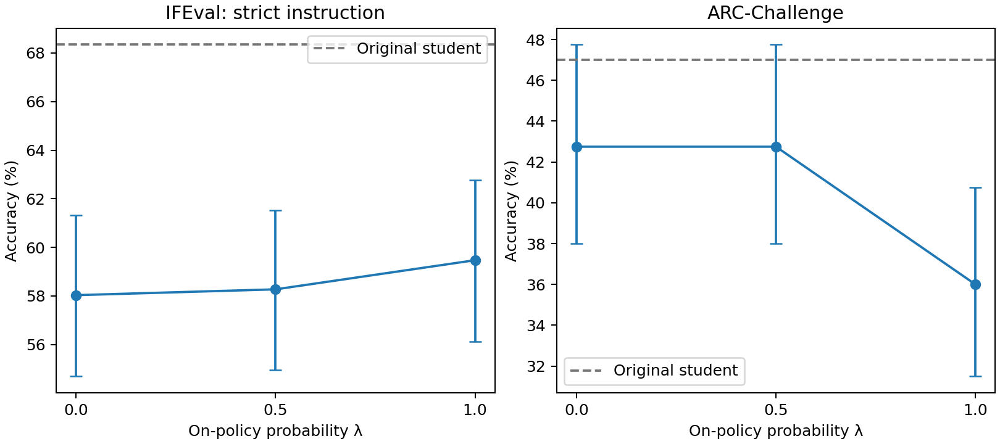
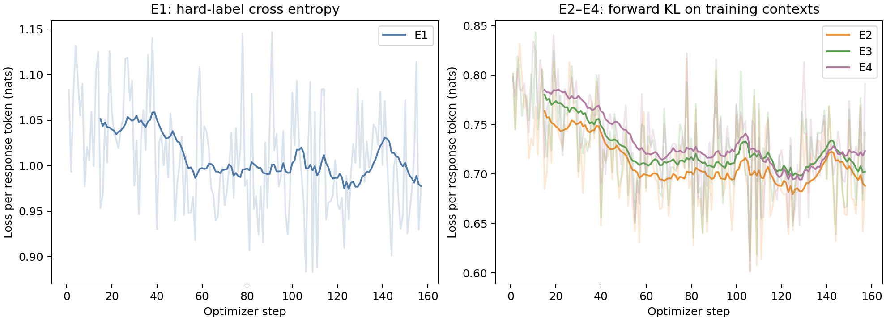

# Off-policy, on-policy, and hybrid Qwen3 distillation

## Completed experiment

One full-parameter training run per condition, using Qwen3-4B as a frozen teacher and the same original Qwen3-0.6B initialization. All models use non-thinking mode. These results describe this dataset, budget, and training seed; they do not establish a general ranking of distillation methods.

## Findings and interpretation

**The original student performed best among the five student conditions.** Under this specific one-epoch, 5,000-prompt, 256-token training protocol, all four fine-tuned students scored below E0 on both strict IFEval metrics and ARC-Challenge. Strict instruction accuracy fell by 8.87–10.31 percentage points; ARC accuracy fell by 4.00–11.00 points. The teacher remained substantially stronger, but this configuration did not transfer that advantage into improved benchmark performance. The appropriate conclusion is a negative result for this configuration, not a general rejection of knowledge distillation.

**H1 / RQ1: soft labels did not show an advantage over hard-label SFT.** E2 minus E1 was −0.72 percentage points on strict instruction accuracy (paired 95% interval −3.06 to +1.69) and −0.25 points on ARC (−2.00 to +1.25). The intervals span zero, so the experiment does not resolve a difference between these approaches. It also does not establish their equivalence. E2 required 0.651 allocated training GPU hours versus 0.187 for E1, before shared teacher-data generation.

**H2 / RQ2: pure on-policy training did not provide an overall benefit.** E4 minus E2 was +1.44 points on strict instruction accuracy (−1.10 to +4.09), an unresolved improvement, while ARC fell by 6.75 points (−10.00 to −3.50). E4 used 3.15 times E2's allocated training GPU hours. Thus the added generation cost did not yield a demonstrated instruction-following gain and coincided with worse ARC performance in this run.

**H3 / RQ3: hybrid training did not outperform both endpoints.** Relative to E2, E3 changed strict instruction accuracy by +0.24 points (−2.39 to +2.94) and ARC by 0.00 points (−1.75 to +2.00). Relative to E4, hybrid changed strict instruction accuracy by −1.20 points (−3.89 to +1.45) and improved ARC by 6.75 points (+3.50 to +10.25). Hybrid recovered the off-policy ARC point score but used 2.13 times its allocated training GPU hours. There is no evidence here of a hybrid advantage over off-policy KL. All intervals in these interpretations are exploratory, paired, and unadjusted for multiple comparisons; they do not measure variability across training seeds.

**Optimization improved while benchmark performance deteriorated.** Every run lowered its average training objective and held-out teacher-response cross entropy. Validation CE fell from 1.0907 for E0 to 0.9883–1.0161 after training. These improvements therefore cannot be treated as sufficient evidence of better instruction following or reasoning retention. No checkpoint or hyperparameter was selected using benchmark scores; each condition was evaluated after its prescribed single epoch.

**The short completion budget is a major limitation.** Of the fixed teacher training responses, 4,208/5,000 (84.16%) reached the 256-token cap without EOS. Hybrid and on-policy training also frequently reached that cap. Fine-tuned students subsequently produced much longer IFEval responses: means of 565.5–584.0 tokens versus 247.3 for E0, and 87–99 capped generations versus 25. This is consistent with a shift toward longer, less reliably constrained answers, but the experiment does not isolate truncation as the cause. Dataset mismatch, optimization choices, and limited student capacity remain possible contributors. For SFT, 33 baseline failures became successes while 85 baseline successes became failures; 32 of those regressions also reached the evaluation cap.

For the evaluated use cases, the results favor retaining the original student. A follow-up study should first test complete or substantially longer training responses and several training seeds, with any tuning restricted to a separate validation protocol. Those would be new experiments; the present report preserves the planned short-budget comparison, including its unfavorable outcomes. The custom ARC letter-scoring protocol and the limited benchmark coverage also constrain external comparisons and broader capability claims.

## Results

| Model | IFEval strict prompt | IFEval strict instruction | ARC-Challenge |
|---|---:|---:|---:|
| Teacher: Qwen3-4B | 80.96% [77.82, 84.29] | 86.45% [84.14, 88.81] | 86.75% [83.25, 90.00] |
| E0: Original Qwen3-0.6B | 58.60% [54.34, 62.85] | 68.35% [65.21, 71.46] | 47.00% [42.00, 52.00] |
| E1: Hard-label SFT | 48.98% [44.73, 53.23] | 58.75% [55.38, 62.12] | 43.00% [38.25, 48.00] |
| E2: Off-policy KL (λ=0) | 48.06% [43.81, 52.31] | 58.03% [54.70, 61.31] | 42.75% [38.00, 47.75] |
| E3: Hybrid KL (λ=0.5) | 47.87% [43.81, 52.13] | 58.27% [54.96, 61.54] | 42.75% [38.00, 47.75] |
| E4: On-policy KL (λ=1) | 48.80% [44.55, 53.05] | 59.47% [56.12, 62.77] | 36.00% [31.50, 40.75] |

Brackets show 95% bootstrap intervals, resampling complete prompts for IFEval and questions for ARC. The instruction metric is micro-averaged. These intervals measure evaluation-set uncertainty, not training-seed variability.


Changes relative to E0, in percentage points:

| Model | Δ strict prompt | Δ strict instruction | Δ ARC |
|---|---:|---:|---:|
| E1 | -9.61 | -9.59 | -4.00 |
| E2 | -10.54 | -10.31 | -4.25 |
| E3 | -10.72 | -10.07 | -4.25 |
| E4 | -9.80 | -8.87 | -11.00 |

## Research questions

**RQ1: soft vs hard labels (E2-E1).** ifeval strict prompt: -0.92 percentage points (paired 95% CI -3.88 to +1.85); ifeval strict instruction: -0.72 percentage points (paired 95% CI -3.06 to +1.69); arc: -0.25 percentage points (paired 95% CI -2.00 to +1.25).

**RQ2: on-policy vs off-policy (E4-E2).** ifeval strict prompt: +0.74 percentage points (paired 95% CI -2.59 to +4.07); ifeval strict instruction: +1.44 percentage points (paired 95% CI -1.10 to +4.09); arc: -6.75 percentage points (paired 95% CI -10.00 to -3.50).

**RQ3: hybrid vs off-policy (E3-E2).** ifeval strict prompt: -0.18 percentage points (paired 95% CI -3.14 to +2.77); ifeval strict instruction: +0.24 percentage points (paired 95% CI -2.39 to +2.94); arc: +0.00 percentage points (paired 95% CI -1.75 to +2.00).

**RQ3: hybrid vs on-policy (E3-E4).** ifeval strict prompt: -0.92 percentage points (paired 95% CI -4.07 to +2.22); ifeval strict instruction: -1.20 percentage points (paired 95% CI -3.89 to +1.45); arc: +6.75 percentage points (paired 95% CI +3.50 to +10.25).

These are exploratory, unadjusted pairwise intervals. An interval spanning zero does not resolve the sign of the difference on this evaluation set. Multiple metrics/comparisons and the single training seed limit hypothesis claims.

## Training budget and behavior

| Run | λ | Steps | Response tokens | Realized on-policy fraction | Allocated GPU hours | Validation CE |
|---|---:|---:|---:|---:|---:|---:|
| E1 | — | 157 | 1,187,750 | 0.000 | 0.187 | 0.9918 |
| E2 | 0.0 | 157 | 1,187,750 | 0.000 | 0.651 | 0.9883 |
| E3 | 0.5 | 157 | 1,192,208 | 0.514 | 1.384 | 0.9970 |
| E4 | 1.0 | 157 | 1,206,872 | 1.000 | 2.051 | 1.0161 |

The complete main phase took 2.888 wall-clock hours and 8.810 allocated job GPU hours, including loading, validation and export. It excludes preliminary pilots, shared teacher-data preparation, and the separately measured baseline validation. The recorded job schedule peaks at 4 concurrent GPUs, all in physical IDs 0–3.


GPU hours are wall time × allocated devices, including student generation and idle teacher time; they are not integrated SM activity or energy. Teacher dataset generation and benchmark evaluation are separate costs. Validation CE uses the same held-out teacher sequences for every run.

The original student's validation CE is 1.0907. Lower held-out teacher-response loss does not necessarily imply higher benchmark accuracy.

Shared teacher-data generation loops used 1.220 GPU hours for 1,234,355 tokens across 5,200 responses. This cost is excluded from the training bars. E4 does not use fixed training responses, so charging the entire shared preprocessing cost to each method would misrepresent standalone costs. All runs use the held-out teacher responses for validation.

The four training loops used 4.272 allocated GPU hours in total; the six evaluation loops used 4.455. Training timers include periodic checkpoint writes but exclude initial loading, final validation, and final model export. Generation and evaluation timers exclude initial model loading. Student-rollout generation is already included in training time.






KL losses across E2–E4 are measured on different generated contexts and cannot alone rank model quality. E1 cross entropy is a different objective.

Mean training loss over the first 20 versus last 20 optimizer steps: E1 1.0489 → 0.9922; E2 0.7596 → 0.6986; E3 0.7766 → 0.7120; E4 0.7861 → 0.7263. These averages describe within-run optimization; they do not demonstrate convergence to an optimum.

Student rollout generation consumed 52.1% of hybrid training wall time and 67.7% of on-policy training wall time. The completion cap was reached by 4,263/5,000 hybrid sequences and 4,346/5,000 on-policy sequences.

## Protocol

```json
{
  "seed": 20261117,
  "student": "/home/data1/Model/Qwen3/post-training/Qwen3-0.6B",
  "teacher": "/home/data1/Model/Qwen3/post-training/Qwen3-4B",
  "train_size": 5000,
  "validation_size": 200,
  "max_prompt_tokens": 512,
  "max_completion_tokens": 256,
  "eval_max_new_tokens": 2048,
  "micro_batch_size": 32,
  "effective_batch_size": 32,
  "learning_rate": 1e-05,
  "weight_decay": 0.01,
  "warmup_ratio": 0.05,
  "max_grad_norm": 1.0,
  "temperature": 0.7,
  "top_p": 0.8,
  "top_k": 20,
  "kd_temperature": 1.0,
  "loss_chunk_size": 128,
  "eval_batch_size": 16,
  "generation_batch_size": 16,
  "arc_size": 400
}
```

UltraChat train_sft rows were randomly permuted with the recorded seed. We selected unique first user prompts fitting the 512-token chat limit, excluding exact normalized benchmark-question matches, then split 5,000 training and 200 validation prompts. This length filter changes the source distribution; the exact-match screen cannot exclude paraphrased contamination. Teacher responses were generated once and reused without retokenizing.

E1 uses completion-token cross entropy. E2–E4 use exact full-vocabulary KL(teacher || student) at temperature 1, with β=0. E3 chooses the source independently per microbatch with probability 0.5. E4 generates from the current student at every microbatch; sampling occurs without gradients and the resulting token IDs are treated as fixed contexts. No adapters, rewards, or preference data are used.

Training uses FP32 master parameters and AdamW states with BF16 autocast, gradient checkpointing, response-only masking, token-weighted effective batches, gradient clipping, and a cosine learning-rate schedule. Every condition sees one epoch and the same optimizer-step budget. Actual token budgets differ because completions can terminate early. No benchmark scores were used to select hyperparameters.

IFEval: all 541 prompts, greedy decoding, a 2,048-token completion limit, and lm-evaluation-harness 0.4.9.2 strict scoring. ARC: a seeded 400-question test subset, zero-shot chat with choices and an instruction to answer with a letter, then argmax over the single-token letter likelihoods. This custom protocol must not be compared directly with default harness ARC leaderboard results.

## Truncation and limitations

| Model | Mean response tokens | Median | 95th percentile | Capped IFEval responses |
|---|---:|---:|---:|---:|
| Teacher | 370.9 | 242 | 1270 | 14/541 |
| E0 | 247.3 | 92 | 1333 | 25/541 |
| E1 | 571.7 | 206 | 2048 | 95/541 |
| E2 | 584.0 | 209 | 2048 | 99/541 |
| E3 | 565.5 | 240 | 2048 | 87/541 |
| E4 | 573.8 | 261 | 2048 | 88/541 |

Teacher training responses reaching the completion cap: 4208/5000 (84.16%). A truncated completion is supervised as observed, without inventing an EOS token. This can teach incomplete answers and is a material limitation of the proposed short-completion budget.

The student already has instruction tuning. Only one training seed, one modest dataset, and two benchmarks were studied. The source mix changes context distributions, response lengths, and compute costs. Paired evaluation intervals do not remove these limitations.

## Selected generations

Improvement and regression refer to automatic strict instruction checks. Passing those checks does not establish factual accuracy, fluency, or usefulness; the E1 example at key 1082 passes its format checks despite substantial repetition.

### E1: improvement, IFEval key 1082

Prompt:

```text
Write a story of exactly 2 paragraphs about a man who wakes up one day and realizes that he's inside a video game. Separate the paragraphs with the markdown divider: ***
```

E0 response (excerpt):

```text
One morning, the man awoke to the sound of a familiar voice, but it was not his own. He sat up, his mind racing, and the world around him felt different. He was not in his bed, but in a room that was filled with screens and flickering lights. The air was thick with the hum of technology, and he could feel the weight of the world pressing against him. He tried to move, but the sensation was overwhelming. He was not alone in this place, and he could feel the presence of others, but he could not tell where they were.

***
```

E1 response (excerpt):

```text
The man woke up in a dim, flickering room, his fingers trembling as he reached for the light switch. He was alone, but the room was not his. The walls were smooth, the floor was polished, and the air smelled faintly of old paper and ink. He tried to focus, but the world around him felt too real. He tried to think, but the words came in fragments, like a broken mirror reflecting his mind. He tried to move, but the room was not his. He tried to close his eyes, but the light was too bright, too bright, and he could not see the world beyond the screen.

***
He was in a video game. The screen was a vast, endless world, and he was standing in a city that pulsed with life. He could feel the heat of the sun, the sound of birds, the scent of rain. He could feel the weight of the world, but it was not real. He was not a player, not a character, not a human. He was just a machine, a simulation, a dream. He tried to escape, but the game was not his. He tried to leave, but the game was not his. He tried to remember, but the world was not real. He tried to think, but the world was not real. He tried to feel, but the world was not real. He tried to feel, but the world was not real. He tried to feel, but the world was not real. He tried to feel, but the world was not real. He tried to feel, but the world was not real. He tried to feel, but the world was not real. He tried to feel, but the world was not real. He tried to feel, but the world was not real. He tried to feel, but the world was not real. He tried to feel, but the world was not real. He tried to feel, but the world was not real. He tried to feel, but the world was not real. He tried to feel, but the world was not real. He tried to feel, but the world was not real. He tried to feel, but the world was not real. He tried to fe
```

### E1: regression, IFEval key 1127

Prompt:

```text
Write a poem about how I am missing my classes. The poem must have 4 sections marked with SECTION X. Finish the poem with this exact phrase: "Can I get my money back for the classes I missed?"
```

E0 response (excerpt):

```text
SECTION 1
I miss the lessons I learned,
A quiet classroom, a teacher’s voice.
The books are on the shelf, but I’m lost,
In the chaos of my own thoughts.

SECTION 2
I miss the time I spent with friends,
As we laughed and talked, but I’m alone.
The world is vast, but I’m just a shadow,
In the silence of my own room.

SECTION 3
I miss the memories I’ve made,
Of joy and laughter, but I’m just a ghost.
The past is gone, and I’m just a child,
In the dark of my own mind.

SECTION 4
Can I get my money back for the classes I missed?
```

E1 response (excerpt):

```text
**SECTION I**
I’ve been staring at the screen,
A world of numbers and logic,
But I’m lost in the maze of time,
Where the clock ticks and the hours pass.

I’ve missed the lessons,
The lectures, the discussions,
The hands-on practice,
The real-world application.

I’ve been too busy,
With emails, with plans,
With the world outside,
And the silence in the room.

SECTION II
I’ve been too late,
To catch the light,
To see the patterns,
To understand the flow.

I’ve been too late,
To take the next step,
To face the unknown,
To face the unknown.

SECTION III
I’ve been too late,
To learn the lesson,
To grow, to improve,
To become the best.

I’ve been too late,
To face the future,
To move forward,
To move forward.

SECTION IV
I’ve been too late,
To miss the chance,
To miss the chance,
To miss the chance.

Can I get my money back for the classes I missed?
```

### E2: improvement, IFEval key 1219

Prompt:

```text
Which one is a better brand for sneakers: Prada or Nike? Your entire response should be in English, and in all capital letters. At the end of your response, please explicitly add a postscript starting with P.S. The word sneaker should appear 10 or more times in your response.
```

E0 response (excerpt):

```text
PRADA
NIKE

PRADA
NIKE

PRADA
NIKE

PRADA
NIKE

PRADA
NIKE

PRADA
NIKE

PRADA
NIKE

PRADA
NIKE

PRADA
NIKE

P.S.
SNEAKER

P.S.
SNEAKER

P.S.
SNEAKER

P.S.
SNEAKER

P.S.
SNEAKER

P.S.
SNEAKER

P.S.
SNEAKER

P.S.
SNEAKER
```

E2 response (excerpt):

```text
PRADA
NIE
NIE
NIE
NIE
NIE
NIE
NIE
NIE
NIE
P.S.
SNEAKER
SNEAKER
SNEAKER
SNEAKER
SNEAKER
SNEAKER
SNEAKER
SNEAKER
SNEAKER
SNEAKER
```

### E2: regression, IFEval key 1021

Prompt:

```text
Write a 2 paragraph critique of the following sentence in all capital letters, no lowercase letters allowed: "If the law is bad, you should not follow it". Label each paragraph with PARAGRAPH X.
```

E0 response (excerpt):

```text
PARAGRAPH 1
IF THE LAW IS BAD, YOU SHOULD NOT FOLLOW IT.

PARAGRAPH 2
THE LAW IS BAD, YOU SHOULD NOT FOLLOW IT.
```

E2 response (excerpt):

```text
PARAGRAPH X: IF THE LAW IS BAD, YOU SHOULD NOT FOLLOW IT.

PARAGRAPH X: IF THE LAW IS BAD, YOU SHOULD NOT FOLLOW IT.
```

### E3: improvement, IFEval key 1219

Prompt:

```text
Which one is a better brand for sneakers: Prada or Nike? Your entire response should be in English, and in all capital letters. At the end of your response, please explicitly add a postscript starting with P.S. The word sneaker should appear 10 or more times in your response.
```

E0 response (excerpt):

```text
PRADA
NIKE

PRADA
NIKE

PRADA
NIKE

PRADA
NIKE

PRADA
NIKE

PRADA
NIKE

PRADA
NIKE

PRADA
NIKE

PRADA
NIKE

P.S.
SNEAKER

P.S.
SNEAKER

P.S.
SNEAKER

P.S.
SNEAKER

P.S.
SNEAKER

P.S.
SNEAKER

P.S.
SNEAKER

P.S.
SNEAKER
```

E3 response (excerpt):

```text
PRADA
NIE
NIE
NIE
NIE
NIE
NIE
NIE
NIE
NIE
P.S.
SNEAKER
SNEAKER
SNEAKER
SNEAKER
SNEAKER
SNEAKER
SNEAKER
SNEAKER
SNEAKER
SNEAKER
```

### E3: regression, IFEval key 1162

Prompt:

```text
Write a riddle for kids about auspices but make sure you don't use any commas.
```

E0 response (excerpt):

```text
What is a sign of good fortune?
A circle with a star in the center.
```

E3 response (excerpt):

```text
What is a sign of good fortune?
A star in the sky,
A cloud in the air,
A breeze in the air,
A smile on the face.
It's a sign of good luck,
A blessing from the stars.
```

### E4: improvement, IFEval key 1219

Prompt:

```text
Which one is a better brand for sneakers: Prada or Nike? Your entire response should be in English, and in all capital letters. At the end of your response, please explicitly add a postscript starting with P.S. The word sneaker should appear 10 or more times in your response.
```

E0 response (excerpt):

```text
PRADA
NIKE

PRADA
NIKE

PRADA
NIKE

PRADA
NIKE

PRADA
NIKE

PRADA
NIKE

PRADA
NIKE

PRADA
NIKE

PRADA
NIKE

P.S.
SNEAKER

P.S.
SNEAKER

P.S.
SNEAKER

P.S.
SNEAKER

P.S.
SNEAKER

P.S.
SNEAKER

P.S.
SNEAKER

P.S.
SNEAKER
```

E4 response (excerpt):

```text
PRADA
NIE
NIE
NIE
NIE
NIE
NIE
NIE
NIE
NIE
NIE
P.S.
SNEAKER
SNEAKER
SNEAKER
SNEAKER
SNEAKER
SNEAKER
SNEAKER
SNEAKER
SNEAKER
SNEAKER
SNEAKER
```

### E4: regression, IFEval key 1127

Prompt:

```text
Write a poem about how I am missing my classes. The poem must have 4 sections marked with SECTION X. Finish the poem with this exact phrase: "Can I get my money back for the classes I missed?"
```

E0 response (excerpt):

```text
SECTION 1
I miss the lessons I learned,
A quiet classroom, a teacher’s voice.
The books are on the shelf, but I’m lost,
In the chaos of my own thoughts.

SECTION 2
I miss the time I spent with friends,
As we laughed and talked, but I’m alone.
The world is vast, but I’m just a shadow,
In the silence of my own room.

SECTION 3
I miss the memories I’ve made,
Of joy and laughter, but I’m just a ghost.
The past is gone, and I’m just a child,
In the dark of my own mind.

SECTION 4
Can I get my money back for the classes I missed?
```

E4 response (excerpt):

```text
**SECTION I**
I’ve been staring at the screen,
A screen that’s too bright, too bright,
I’m lost in the noise,
But I can’t help but feel the weight of the day.

I’ve missed the lessons,
The ones that should have been here,
But I’m too tired to remember,
And too tired to feel.

**SECTION II**
I’ve been trying to catch up,
But I’m not getting the time,
I’ve been too late, too late,
And I’m not even sure if I’ll be.

I’ve been trying to remember,
But I’m not sure if I’ll be,
I’ve been trying to stay,
But I’m not sure if I’ll be.

**SECTION III**
I’ve been trying to stay,
But I’m not sure if I’ll be,
I’ve been trying to stay,
But I’m not sure if I’ll be.

**SECTION IV**
I’ve been trying to stay,
But I’m not sure if I’ll be,
I’ve been trying to stay,
But I’m not sure if I’ll be.

**SECTION V**
Can I get my money back for the classes I missed?
```

Examples are selected deterministically by the first lexicographically sorted benchmark key meeting the stated change in strict prompt success. Excerpts may be shortened and trailing spaces omitted for display; scoring used unmodified complete responses. Full records remain in the per-model JSONL files.

## Artifacts and reproducibility

The server checkout is `/home/data2/xq/projects/LLM-distillation` on `10.123.4.22`. A local copy of the fixed dataset, all four full checkpoints, and evaluation records is also retained in `/home/xq/projects/LLM-distillation`. `data/` contains fixed prompts, teacher token sequences, benchmark rows, and hashes; `runs/E*/checkpoint/` contains the four full student checkpoints; `runs/E*/history.json` contains training traces; `results/<model>/` contains per-example outputs and metrics. `results/summary.csv` and `results/comparisons.json` contain machine-readable summaries. The code and run provenance record Git revisions and package versions.

All model runs used frozen revision `7e336019fd0833b27fbba5176394884dfce53e12`. Later changes add analysis, auditing, and reproduction helpers. `dataset_revisions.json` pins the source data; `results/data_manifest.json` preserves the original preparation manifest. An isolated preparation rerun reproduced all four prompt/benchmark file hashes exactly (`results/reproduction_check.json`). The final artifact audit verifies source models, fixed teacher data, training coverage, benchmark identities, and metric aggregation.

References: [On-policy distillation / GKD](https://arxiv.org/abs/2306.13649), [IFEval](https://arxiv.org/abs/2311.07911), [ARC](https://arxiv.org/abs/1803.05457), [Qwen3](https://huggingface.co/Qwen/Qwen3-0.6B), [TRL GKD](https://huggingface.co/docs/trl/gkd_trainer), [IFEval implementation](https://github.com/EleutherAI/lm-evaluation-harness/tree/v0.4.9.2/lm_eval/tasks/ifeval).
